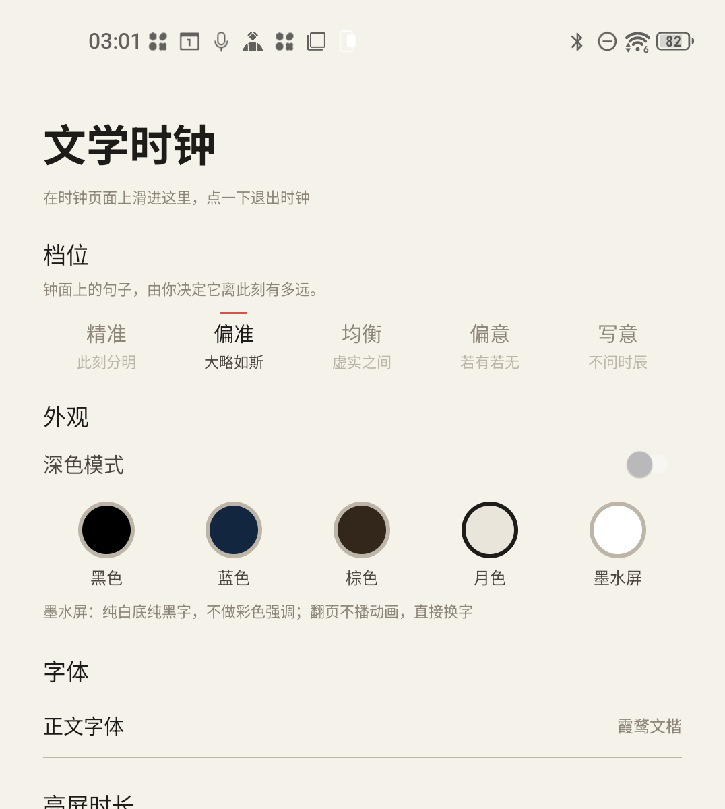

# 文学时钟 · Wenxue Shizhong

[](LICENSE)
[](#安装)
[](../../releases)
[](../../actions/workflows/build.yml)

把手机变成一面文学钟：每一分钟，屏幕上浮现一句与此刻有关的文学句子，句中的时间词染成朱砂色。

不是报时工具，而是用文学的方式读时间。


### 为什么值得试

- **与这一刻有关**：句子里的时间词与钟面相照，不只是随机摘录。
- **离线且干净**：无广告、无账号；只有主动下载字体时才访问 GitHub Releases。
- **可以有自己的选本**：留下喜欢的，屏蔽不想看的，也能导入自己挑的句子。

### 现状

| 公有领域语料 | 分钟覆盖 | 单 APK | 系统要求 |
|---|---|---|---|
| 2307 句 | 1440 / 1440 分钟 | 2.0 MB | Android 8.0+ |

包名：`io.github.mangi.clock` · 源码：[GitHub](https://github.com/Kermityang/wenxue-shizhong)

## 核心功能

- **五档**：精准 / 偏准 / 均衡 / 偏意 / 写意，从写明了钟点的句子，到时辰与景致。
- **喜欢与屏蔽**：长按句子管理名单；喜欢的更常出现，屏蔽的不再出现。
- **语料导入**：手动添加单句，或复制内置 AI 提示词批量生成 JSON 后导入；支持导出备份、按批次删除与跨库去重。
- **字体切换**：可选霞鹜文楷、马善政毛笔楷书、志莽行书、刘建毛草、思源宋体；下载时校验 SHA-256。
- **深浅色与墨水屏**：设置页跟随深浅色主题；墨水屏模式纯白底黑字，翻页不播动画。



## 安装

从 [Releases](../../releases) 下载 `clock-x.y.apk` 直接安装（Android 8.0+）。

**Release 里的包是「完整包」**：内嵌霞鹜文楷子集（约 1.8MB，含 OFL 许可文本），装上就是截图里的样子，不需要额外配置。

桌面图标是一个细线钟面。点开即全屏显示；**点一下**退出，**上滑**进设置。

> Actions 里自动构建出的 artifact 用的是**每次 CI 现生成的临时证书**，它只是编译体检的产物——别拿来安装或转发（换证书就没法覆盖升级了）；正式分发请用 Release 的包。

## 构建

需要 JDK 11+、Android SDK（build-tools + platform）。`r8.jar` 不是必需的——build-tools 自带的 `d8` 就够。

```sh
export ANDROID_SDK_ROOT=/path/to/android-sdk
./build.sh          # 产物：clock.apk
```

**脚本不写死路径**，所以本地和 CI 用同一份：

- 源码目录 `APP` 取脚本自身所在目录
- 构建工具按顺序找：`CLOCK_BUILD_TOOLS` → `/opt/asdk/ast/build-tools`（维护者本机）→ `$ANDROID_SDK_ROOT/build-tools/` 里最新的一版
- `android.jar` 同理：`CLOCK_ANDROID_JAR` → `/opt/asdk/pf/android-34/android.jar` → `$ANDROID_SDK_ROOT/platforms/android-*/` 里最新的
- d8 优先用 build-tools 自带的 `d8` 可执行文件；没有才退回 `CLOCK_R8_JAR`（默认 `/workspace/tools/r8.jar`）里的 r8
- 找不到工具链会直接报错退出

可用环境变量：`CLOCK_CORPUS`（换成自己的语料文件，会连带重切字体子集）、`CLOCK_VERSION_CODE`、`CLOCK_VERSION_NAME`、`CLOCK_BUILD_TOOLS`、`CLOCK_ANDROID_JAR`、`CLOCK_R8_JAR`。签名用的 keystore 与口令走 `CLOCK_KEYSTORE`、`CLOCK_STOREPASS` 两个变量，见下节「签名」。

`assets/LXGWWenKai-Light.ttf` 是霞鹜文楷的子集，仓库里附带，所以打出来的包自带字体。重切子集需要 `fontTools`（`pip install fonttools`）；没装的话这一步会跳过，直接用仓库里现成的子集。

CI 配置在 `.github/workflows/build.yml`：push 到 main 或打 tag 都会跑一遍 `./build.sh`，**只作构建体检**——artifact 用临时证书签名，不是发布包。CI 不发布任何东西：Release 里的包由维护者在本地用固定证书构建后手动上传（换证书就无法覆盖升级，这一点比省事重要）。

### 签名

仓库里**没有**签名文件，也**没有**口令。自己生成一个（`keytool` 会提示你输入新口令，别照抄别人的）：

```sh
keytool -genkeypair -keystore release.jks -alias clock -keyalg RSA -keysize 2048 \
        -validity 10000 -dname "CN=clock"
```

口令不写进脚本、不写进仓库，构建时用两个环境变量给：

```sh
export CLOCK_KEYSTORE=/path/to/release.jks   # 不给就找 ./release.jks、../clock-signing/release.jks
export CLOCK_STOREPASS='你的口令'             # 或写进 keystore 同目录的 signing.env
./build.sh
```

`signing.env` 只有一行 `CLOCK_STOREPASS=…`，`build.sh` 发现就会自动读。`*.jks`、`*.keystore`、`signing.env` 都在 `.gitignore` 里，不会误提交。注意：**换签名后无法覆盖升级**，请自己保管好这个文件。

### 字体与子集

界面默认使用 **霞鹜文楷 Light**（LXGW WenKai v1.520，SIL OFL 1.1，© LXGW）。上游完整字体约 28MB，直接放进 APK 太重，
所以本项目用的是**按字符子集化**后的版本（约 1.8MB / 3234 字形），这个子集随仓库提供，clone 下来就能构建。

子集是**构建时自动生成**的：`build.sh` 会跑 `tools/make_subset.sh`，它用 `tools/collect_chars.py` 收集
「语料 + 出处 + 界面文案」用到的全部字符，再交给 `pyftsubset` 切分。换语料后不需要维护字符表，也不会漏字。

```sh
# 手动跑（需要 fonttools：pip install fonttools）
sh tools/make_subset.sh /path/to/LXGWWenKai-Light.ttf
```

找不到全字体或没有 pyftsubset 时，这一步自动跳过，沿用仓库里已有的子集。

> 早先版本靠手工维护的 `docs/chars.txt`，换语料后漏字，表现为**个别字掉回系统字体**——同一页里混进宋体字形。
> v2.01 起改为构建时自动收集，这类缺字不会再出现。

## 语料

`assets/clock.json` 是一张静态表，每条形如：

```json
{"time": "23:00", "s": "三更灯火五更鸡，正是男儿读书时。", "h": "三更", "b": "颜真卿　《劝学》"}
```

- `time`：对应分钟（`HH:MM`）
- `s`：正文
- `h`：要标红的时间短语（必须是 `s` 的子串）
- `b`：出处，写成 `作者　《书名》`

**仓库里的语料全部是公有领域作品**：**1803 句**，覆盖 1440/1440 分钟。取材自
诗经、楚辞、先秦诸子、史记汉书、全唐诗、千家诗、宋词三百首、元曲、明清小说（水浒、西游、三国、红楼、
儒林、聊斋、说岳、金瓶梅）、宋人笔记（东京梦华录、梦粱录、武林旧事、老学庵笔记）、敦煌曲子词，
以及**清末民初小说**——刘鹗《老残游记》、吴趼人《二十年目睹之怪现状》《九命奇冤》《恨海》、
李宝嘉《官场现形记》《文明小史》、曾朴《孽海花》、韩邦庆《海上花列传》、蘧园《负曝闲谈》、
忧患余生《邻女语》，另有鲁迅、老舍、萧红、郁达夫的部分短句。

> 公有领域按**中国著作权法**（作者逝世满 50 年）判断。若你的分发地适用美国法（1929 年前出版），
> 《骆驼祥子》（1936）、《呼兰河传》（1941）这类需要自行剔除；同样，本仓库不含任何现代小说的中译本。

**不含仍在版权保护期内的作品**，包括现代小说的中译本。理由见 [ATTRIBUTION.md](ATTRIBUTION.md)：
那些译文的权利属于原作者与译者，公开分发不属于合理使用。

自带 App 只读这一个文件；想换成自己的句子，直接按上面的格式改 `assets/clock.json` 或用自己的文件构建：

```sh
CLOCK_CORPUS=/path/to/my-corpus.json sh build.sh
```

## 排班是怎么算的

一天 1440 分钟，每条语料只对应一个分钟。没有精确语料的分钟，从「同一小时」的句子里挑候选（默认每个分钟 3 条），并按下面的规则约束：

- 每句最多排进 6 个分钟位（防止某句被反复征用）
- 同一小时的候选之间按使用次数轮转
- 某一小时的句子排满了，宁可让这个分钟留空（运行时退化为「最近一段」），也不硬塞

App 端记两件事：

- **当前分钟的句子**（`pick_minute` / `pick_sentence`）：屏幕旋转、换配色、回前台、进程重建都复用同一句，不会因为重建而跳句；
- **今天已经出现过的句子**（`used_today`，跨午夜清空）：同一分钟有多个候选时，从 `day_of_month` 对应的位置开始轮转，跳过今天用过的；某个分钟的候选今天全用过时，宁可重复这一句，也不跨分钟借句——每句都自带时间词，借来的句子会和屏幕上的时间对不上。

## 已知限制

- 覆盖率取决于你放多少语料。句子少的时候会出现「同一段落只在附近几分钟重复」；语料足够时不会。
- 按日期轮换意味着某些句子可能在一天里出现 2 次左右；这是无状态设计的取舍。
- 目前只有简体中文界面。

## 许可

- 代码：MIT，见 [LICENSE](LICENSE)
- 语料、译本与字体：见 [ATTRIBUTION.md](ATTRIBUTION.md)
- 版本变化：见 [CHANGELOG.md](CHANGELOG.md)
