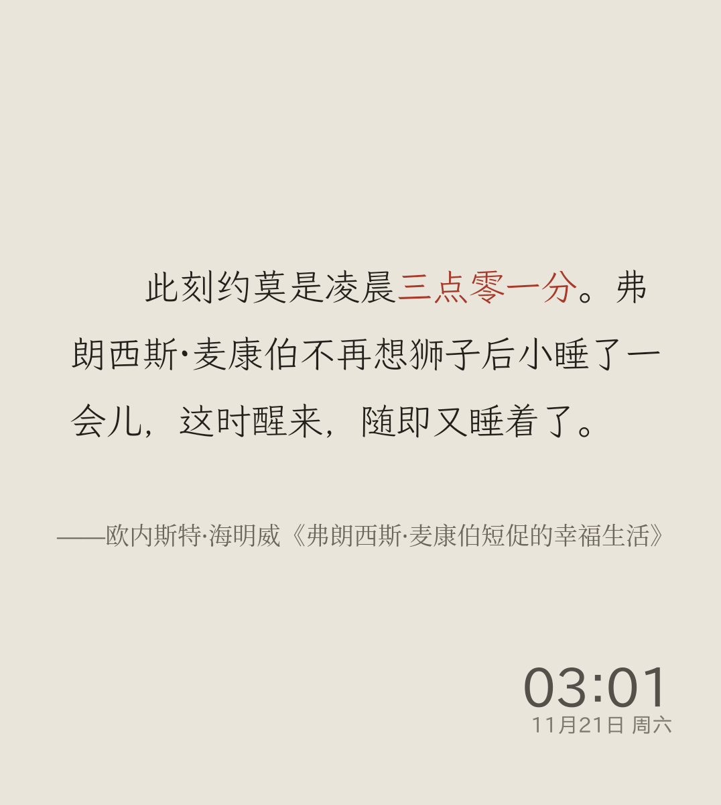

# 文学时钟 · Wenxue Shizhong

[](LICENSE)
[](#安装)
[](../../releases)
[](../../actions/workflows/build.yml)

把手机变成一面**文学钟**：每一分钟，屏幕上出现一句与这个时刻有关的文学句子，句中那个时间词标成红色。

不是报时工具，是把时间读出来的一种方式。



## 最新版本 v2.10 · 语料 1808 句

> 每分钟都有句子；句中时间词标红，且与钟面上的时间对得上。

| | v2.02 | v2.10 |
|---|---|---|
| 句子总数 | 1495 | **1808** |
| 覆盖分钟 | 1440 / 1440 | 1440 / 1440 |
| 字体缺字 | 356 | **0** |
| 钟点与句子不符 | — | **0** |

- **并入清末民初小说 329 条**：刘鹗《老残游记》、吴趼人《二十年目睹之怪现状》《九命奇冤》《恨海》、
  李宝嘉《官场现形记》《文明小史》、曾朴《孽海花》、韩邦庆《海上花列传》、蘧园《负曝闲谈》、
  忧患余生《邻女语》，另有鲁迅、老舍、萧红、郁达夫
- **标红只标时间表达**：`月`/`明月`/`秋月`/`昨夜` 这类夜景物象不再标红；`X 点 Y 分` 的句子必须落在那一分钟
- **排版**：多段文字每段首行都缩进；歌词、短诗（≤14 字、≤1 逗号）按诗居中，不再顶格加缩进；
  单行行距收紧，引文与出处不再被拉开
- **字体子集按语料重切**：3281 字形，缺字 0

下载：[Releases → v2.10](..\/..\/releases\/tag\/v2.10)（`clock-2.10.apk`，完整包）

## 特性

- **整分翻页**：每到整分，页面绕 Y 轴翻转 180°，旧的一段侧翻出去、新的一段转回来
- **时间词标红**：每句都带一个「时间短语」，渲染时单独上色
- **横竖屏自适应**：按屏幕短边缩放字号，横屏时整块垂直居中
- **设置页**：在钟面上**上滑**进入（点一下退出时钟）
  - 背景色：黑色 / 蓝色 / 棕色 / 月色（浅底深字，自动换配色）
  - 亮屏时长：15 / 30 / 60 分钟，或常亮
- **全屏**：铺到状态栏、导航栏、摄像头挖孔区，换浅色背景也不露黑边
- **无广告、无网络、无权限**

## 安装

从 [Releases](../../releases) 下载 `clock-x.y.apk` 直接安装（Android 8.0+）。

**Release 里的包是「完整包」**：内嵌霞鹜文楷子集（约 1.8MB，含 OFL 许可文本），装上就是截图里的样子，不需要额外配置。

桌面图标是一个细线钟面。点开即全屏显示；**点一下**退出，**上滑**进设置。

> Actions 里自动构建出的 artifact（约 50KB）**不带字体**，用途只是验证代码能否编译；正式分发请用 Release 的完整包。

## 构建

需要 JDK 11+、Android SDK（build-tools + platform android-34）和 `r8.jar`。

```sh
export ANDROID_HOME=/path/to/android-sdk
./build.sh          # 产物：clock.apk
```

脚本用到的环境变量：`ANDROID_JAR`、`BUILD_TOOLS`、`R8`、`KEYSTORE`、`STORE_PASS`、`KEY_PASS`、`KEY_ALIAS`，默认值见 `build.sh` 开头。CI 配置在 `.github/workflows/build.yml`：每次 push 自动构建 APK，**只作构建体检**（artifact 用临时证书签名、不含字体，不是发布包）。CI 不发布任何东西——Release 里的包由维护者用固定证书在本机构建后上传。

### 签名

仓库里**没有**签名文件。自己生成一个：

```sh
keytool -genkeypair -keystore release.jks -alias clock -keyalg RSA -keysize 2048 \
        -validity 10000 -storepass etasign -keypass etasign -dname "CN=clock"
```

（`release.jks` 已在 `.gitignore` 里，不会误提交。注意：**换签名后无法覆盖升级**，请自己保管好这个文件。）

### 字体与子集

界面默认使用 **霞鹜文楷 Light**（LXGW WenKai v1.520，SIL OFL 1.1，© LXGW）。上游完整字体约 28MB，直接放进 APK 太重，
所以本项目用的是**按字符子集化**后的版本（约 1.8MB / 3234 字形），这个子集随仓库提供，clone 下来就能构建。

子集是**构建时自动生成**的：`build.sh` 会跑 `tools/make_subset.sh`，它用 `tools/collect_chars.py` 收集
「语料 + 出处 + 界面文案」用到的全部字符，再交给 `pyftsubset` 切分。换语料后不需要维护字符表，也不会漏字。

```sh
# 手动跑（需要 fonttools：pip install fonttools）
sh tools/make_subset.sh /path/to/LXGWWenKai-Light.ttf
```

找不到全字体或没有 pyftsubset 时，这一步自动跳过，沿用仓库里已有的子集。

> 早先版本靠手工维护的 `docs/chars.txt`，换语料后漏字，表现为**个别字掉回系统字体**——同一页里混进宋体字形。
> v2.01 起改为构建时自动收集，这类缺字不会再出现。

## 语料

`assets/clock.json` 是一张静态表，每条形如：

```json
{"time": "23:00", "s": "三更灯火五更鸡，正是男儿读书时。", "h": "三更", "b": "颜真卿　《劝学》"}
```

- `time`：对应分钟（`HH:MM`）
- `s`：正文
- `h`：要标红的时间短语（必须是 `s` 的子串）
- `b`：出处，写成 `作者　《书名》`

**仓库里的语料全部是公有领域作品**：**1808 句**，覆盖 1440/1440 分钟。取材自
诗经、楚辞、先秦诸子、史记汉书、全唐诗、千家诗、宋词三百首、元曲、明清小说（水浒、西游、三国、红楼、
儒林、聊斋、说岳、金瓶梅）、宋人笔记（东京梦华录、梦粱录、武林旧事、老学庵笔记）、敦煌曲子词，
以及**清末民初小说**——刘鹗《老残游记》、吴趼人《二十年目睹之怪现状》《九命奇冤》《恨海》、
李宝嘉《官场现形记》《文明小史》、曾朴《孽海花》、韩邦庆《海上花列传》、蘧园《负曝闲谈》、
忧患余生《邻女语》，另有鲁迅、老舍、萧红、郁达夫的部分短句。

> 公有领域按**中国著作权法**（作者逝世满 50 年）判断。若你的分发地适用美国法（1929 年前出版），
> 《骆驼祥子》（1936）、《呼兰河传》（1941）这类需要自行剔除；同样，本仓库不含任何现代小说的中译本。

**不含仍在版权保护期内的作品**，包括现代小说的中译本。理由见 [ATTRIBUTION.md](ATTRIBUTION.md)：
那些译文的权利属于原作者与译者，公开分发不属于合理使用。

自带 App 只读这一个文件；想换成自己的句子，直接按上面的格式改 `assets/clock.json` 或用自己的文件构建：

```sh
CLOCK_CORPUS=/path/to/my-corpus.json sh build.sh
```

## 排班是怎么算的

一天 1440 分钟，每条语料只对应一个分钟。没有精确语料的分钟，从「同一小时」的句子里挑候选（默认每个分钟 3 条），并按下面的规则约束：

- 每句最多排进 6 个分钟位（防止某句被反复征用）
- 同一小时的候选之间按使用次数轮转
- 某一小时的句子排满了，宁可让这个分钟留空（运行时退化为「最近一段」），也不硬塞

App 端记两件事：

- **当前分钟的句子**（`pick_minute` / `pick_sentence`）：屏幕旋转、换配色、回前台、进程重建都复用同一句，不会因为重建而跳句；
- **今天已经出现过的句子**（`used_today`，跨午夜清空）：同一分钟有多个候选时，从 `day_of_month` 对应的位置开始轮转，跳过今天用过的；某个分钟的候选今天全用过时，宁可重复这一句，也不跨分钟借句——每句都自带时间词，借来的句子会和屏幕上的时间对不上。

## 已知限制

- 覆盖率取决于你放多少语料。句子少的时候会出现「同一段落只在附近几分钟重复」；语料足够时不会。
- 按日期轮换意味着某些句子可能在一天里出现 2 次左右；这是无状态设计的取舍。
- 目前只有简体中文界面。

## 许可

- 代码：MIT，见 [LICENSE](LICENSE)
- 语料、译本与字体：见 [ATTRIBUTION.md](ATTRIBUTION.md)
- 版本变化：见 [CHANGELOG.md](CHANGELOG.md)
